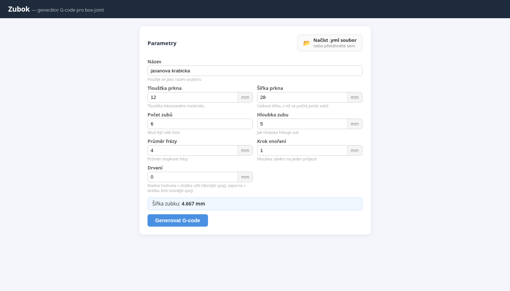
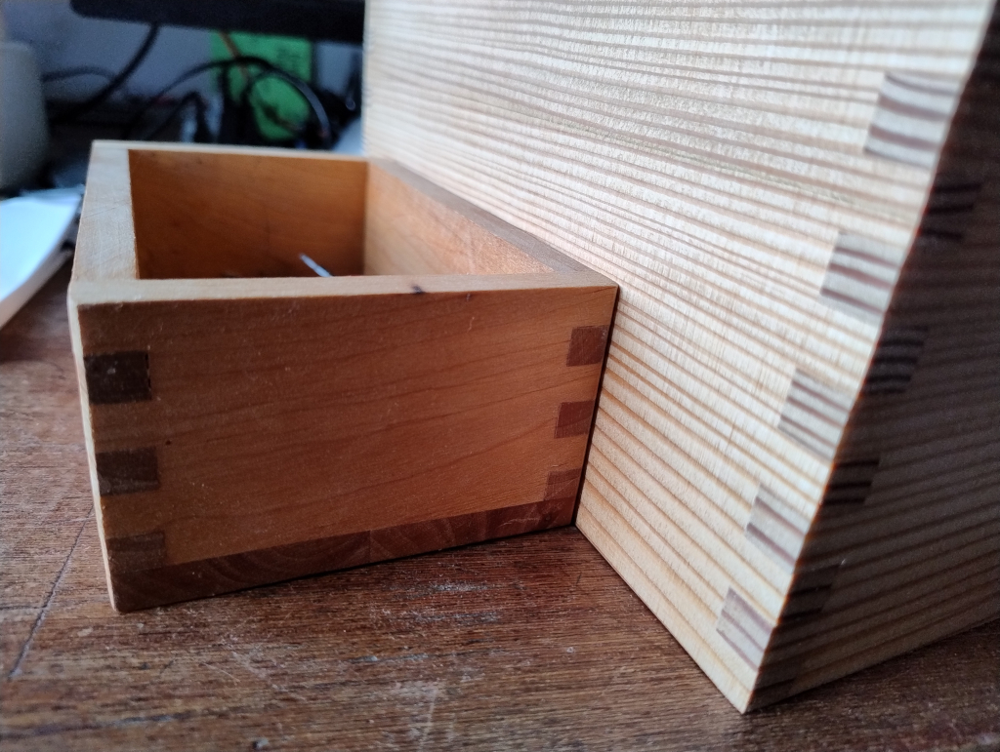

# Zubok Online

Webová aplikace pro generování CNC G-code pro frézování **dřevěných spojů**.
Generátory se přepínají záložkami:

| Záložka | Spoj |
|---------|------|
| **Zubok** | box-joint (prstový spoj) — přepis původního Ruby skriptu |
| **Schody** | schodový pokosový spoj — hrana zkosená po stupních místo roviny 45° |
| **Válec** | kruhová drážka kolem středu — uprostřed zůstane válec |
| **Proporce** | počítadlo rozměrů podle zlatého řezu a příbuzných poměrů (negeneruje G-code) |

Statická Vue 3 aplikace s 3D vizualizací dráhy frézy. **Běží celá v prohlížeči** —
G-code se počítá na klientovi, backend neexistuje. Hotový build je hromádka
souborů, kterou obslouží libovolný webserver.





## Funkce

- Zadání parametrů přes formulář, odvozené hodnoty se dopočítávají živě
- Import parametrů z `.yml` souboru
- Generování dvou G-code souborů (`_a.nc` a `_b.nc`) pro obě prkna spoje
  (válec má jediný soubor)
- 3D vizualizace dráhy frézy v reálném čase (Three.js)
- Animace průjezdu frézy podél dráhy
- Čelní pohled na řez spojem pro kontrolu výsledného tvaru
- Stažení G-code přímo v prohlížeči

## Technologie

| Vrstva | Stack |
|--------|-------|
| Aplikace | Vue 3, Vite |
| Generátory G-code | čistý JavaScript, `client/src/core/` |
| 3D vizualizace | Three.js, OrbitControls |
| Hosting | nginx (statické soubory) |

Node.js je potřeba jen k sestavení buildu. Na serveru už neběží nic.

## Spuštění

### Vývoj

```bash
npm install --prefix client
npm run dev
```

Aplikace běží na `http://localhost:5173`.

### Build

```bash
npm run build      # výsledek v client/dist/
npm run preview    # kontrola buildu lokálně
```

## Nasazení

Na serveru stačí nginx, žádný Node proces.

**Jednorázově** — nastavit vhost (doménu a `root` doplnit v souboru):

```bash
sudo cp deploy/nginx.conf /etc/nginx/sites-available/zubok
sudo ln -s /etc/nginx/sites-available/zubok /etc/nginx/sites-enabled/
sudo nginx -t && sudo systemctl reload nginx
sudo certbot --nginx -d zubok.example.cz     # HTTPS
```

**Při každém nasazení:**

```bash
cp deploy.conf.example deploy.conf   # jen poprvé — vyplnit server a cestu
npm run deploy
```

`deploy.sh` sestaví build a nahraje `client/dist` přes rsync/ssh. Nahrává ve
dvou průchodech — nejdřív aktiva, pak `index.html` a úklid starých souborů —
takže návštěvník, který si stránku načte uprostřed nasazení, nenarazí na
chybějící JavaScript. Přepínače:

| Přepínač | Co dělá |
|----------|---------|
| `--dry-run` | ukáže, co by se přeneslo, na server nezapíše |
| `--no-build` | nasadí už existující `client/dist` |

`deploy.conf` je v `.gitignore`. Vyžaduje ssh klíč — skript běží v `BatchMode`,
takže se na heslo neptá.

## Parametry — Zubok

| Parametr | Popis |
|----------|-------|
| Název | Použije se jako název výstupního souboru |
| Tloušťka prkna | Tloušťka frézovaného materiálu (mm) |
| Šířka prkna | Celková šířka, z níž se počítá počet zubů (mm) |
| Počet zubů | Celé číslo |
| Hloubka zubu | Jak hluboko frézuje zub (mm) |
| Průměr frézy | Průměr stopkové frézy (mm) |
| Krok vnoření | Hloubka záběru na jeden průjezd (mm) |
| Drvení | Kladná = těsnější spoj, záporná = volnější spoj (mm) |

## Parametry — Schody

| Parametr | Popis |
|----------|-------|
| Název | Použije se jako název výstupního souboru |
| Tloušťka prkénka | Tloušťka materiálu; vychází z ní velikost schodu (mm) |
| Délka spoje | Celý bok prkénka (mm) |
| Počet schodů | Předvyplněno z tloušťky (~3 mm na schod), lze přepsat |
| Průměr frézy | Průměr stopkové frézy (mm) |
| Krok vnoření | Hloubka záběru na jeden průjezd (mm) |
| Vůle | Přídavek na každou stěnu schodu — kompenzace různých tvrdostí dřeva (mm) |
| Rychlost posuvu | F v G-code (mm/min) |
| Rozběh vřetene | Čekání na náběh otáček (G04) před prvním řezem (s) |

### Jak schodový spoj funguje

Prkénko je na hraně zkoseno o 45°, takže se slepí s druhým, kolmo postaveným
prkénkem. Zkosení ale není rovina — jde po stupních o straně
`s = tloušťka / počet schodů`. Schody zvětšují lepenou plochu a spoj se
při lepení sám polohuje.

```
 Y:  0────s───2s───3s───4s          (tloušťka = 4s)
     ┌────┐
  A  │    └────┐                    prkno A: hloubka schodu i = t-(i-1)s
     │         └────┐               → první schod jde skrz (ostří pokosu)
     │              └────┐
     └╌╌╌╌ prořez skrz

     ┌────┐
  B  │    └────┐                    prkno B: hloubka schodu i = t-i*s
     │         └────┐               → poslední schod se nefrézuje
     └──────────────┘
```

Prkna A a B jsou posunutá o jeden schod — jinak by do sebe nezapadla.
(Ověřeno rozkladem rohového čtverce na buňky `s × s`: A si bere buňky `i>j`,
B buňky `i<=j`, dohromady přesně celý čtverec bez překryvu i bez mezery.)

**Upnutí a nulování:** prkénko leží na ležato pohledovou stranou dolů, frézuje
se z vnitřní strany. X je podélná osa spoje, Y jde napříč prkénkem, Z se
prohlubuje v rámci tloušťky. Nuluje se stejně jako u zubok — frézou se ručně
dojede na okraj materiálu, takže materiál začíná o poloměr frézy dál.
Nejhlubší schod řeže skrz, **pod prkénko patří obětní deska**.

Program nejdřív roztočí vřeteno a počká na náběh otáček, pak schody odebírá
klikatým pohybem sem a tam po celé délce spoje. Zanořuje se vždy až za koncem
materiálu, tedy ve vzduchu.

## Parametry — Válec

| Parametr | Popis |
|----------|-------|
| Název | Použije se jako název výstupního souboru |
| Průměr válce | Válec, který zůstane uprostřed (mm) |
| Hloubka vnoření | Hloubka drážky kolem válce (mm), výchozí 8 |
| Průměr frézy | Průměr stopkové frézy (mm), výchozí 4 |
| Velikost kroku | Hloubka záběru na jeden oběh (mm), výchozí 0,5 |
| Rychlost posuvu | F v G-code (mm/min), výchozí 200 |
| Rozběh vřetene | Čekání na náběh otáček (G04) před prvním řezem (s), výchozí 3 |

**Nulování:** na rozdíl od zubok a schodů je nula ve **středu válce** (X0 Y0),
Z0 je povrch. Střed frézy jede po kružnici o poloměru
`průměr válce / 2 + poloměr frézy`, drážka je tedy široká jednu frézu.

Program roztočí vřeteno, počká na náběh otáček a pak po vrstvách: v bodě
(`Rc`, 0) se fréza zanoří o krok a objede celou kružnici (dva půloblouky G02,
po směru hodin — sousledně vůči stěně válce). Poslední vrstva je vždy přesně
na plné hloubce.

**Odhadovaná doba** se ukazuje živě ve formuláři a je i v hlavičce G-code:
rozběh vřetene + délka dráhy / posuv (rychloposuvy počítané s 1000 mm/min).
Zrychlení a zpomalení stroje odhad nezahrnuje, skutečnost bývá o něco delší.

## Záložka Proporce

Počítadlo rozměrů, ne generátor — nevzniká z něj G-code. Zadáš jeden rozměr
a ostatní dva se dopočítají podle zvoleného poměru. Tři způsoby:

### Řada mocnin

Rozměry tvoří geometrickou řadu `a : a·r : a·r²`. U každého rozměru se dá
mocnina nastavit zvlášť — pro podlouhlou krabičku dáš delší straně mocninu 3
místo 2 a vznikne poměr φ³ (1 : 4,24) místo φ² (1 : 2,62).

### Střed (Alberti)

Třetí rozměr je pythagorejský střed dvou zbylých. Leon Battista Alberti
v *De re aedificatoria* (1452) takhle odvozuje výšku místnosti z délky a šířky,
Palladio to v *Quattro libri* (1570) používá stejně:

| Střed | Vzorec | Tvar |
|-------|--------|------|
| Aritmetický | `(a + c) / 2` | nejvyšší ze tří |
| Geometrický | `√(a · c)` | stejný poměr k oběma stranám |
| Harmonický | `2ac / (a + c)` | nejpodsaditější |

### Fibonacci

Celá čísla, jejichž podíl se blíží zlatému řezu. Vybíráš, které členy řady
vezmeš — čím dál v řadě, tím přesnější:

| Dvojice | Podíl | Odchylka od φ |
|---------|-------|---------------|
| 2 : 3 | 1,500 | −7,3 % |
| 3 : 5 | 1,667 | +3,0 % |
| 5 : 8 | 1,600 | −1,1 % |
| 8 : 13 | 1,625 | +0,4 % |
| 13 : 21 | 1,615 | −0,2 % |
| 21 : 34 | 1,619 | +0,06 % |

Řada konverguje k φ z **jakékoliv** počáteční dvojice, takže se dá začít
vlastními kulatými čísly (30, 50 → 80, 130, 210, 340) a rozměry zůstanou
odměřitelné metrem.

### Proporční systémy

| Systém | Poměr | Původ |
|--------|-------|-------|
| Zlatý řez (φ) | 1 : 1,618 | Eukleidés; Fibonacci 1202, Pacioli 1509. Ve středověkém stavitelství doložený hůř, než se tvrdí |
| Ad quadratum (√2) | 1 : 1,414 | Úhlopříčka čtverce. Nejrozšířenější doopravdy středověký postup — stačí provázek |
| Ad triangulum (√3) | 1 : 1,732 | Rovnostranný trojúhelník. Spor o stavbu milánského dómu 1392 |
| Odmocnina z 5 | 1 : 2,236 | Úhlopříčka dvojčtverce; √5 = 2φ − 1 |
| Oktáva | 1 : 2 | Hudební poměry — Boëthius předal středověku pythagorejskou nauku |
| Kvinta | 2 : 3 | Z Albertiho a Palladiova seznamu |
| Kvarta | 3 : 4 | Nejkrotší, blízko čtverci |
| Sexta | 3 : 5 | Celočíselná náhrada φ, liší se o 3 % |
| Plastické číslo (ψ) | 1 : 1,325 | Dom Hans van der Laan, benediktin, 1928–1960. Kořen `x³ = x + 1`. Na malé předměty sedí líp než φ — řada roste pomaleji |

## Výstup

Zubok a schody vygenerují dva G-code soubory:

- `<nazev>_a.nc` — program pro první prkno
- `<nazev>_b.nc` — program pro druhé prkno (protikus spoje)

Válec vygeneruje jediný soubor `<nazev>.nc`.

## Struktura projektu

```
zubok-online/
├── client/
│   ├── vite.config.js
│   └── src/
│       ├── App.vue                      # Layout, záložky, volání generátorů
│       ├── core/                        # Výpočetní jádro — čistý JS, bez Vue
│       │   ├── generuj.js               # Vstupní bod: typ + parametry → G-code
│       │   ├── validace.js              # Rozsahy parametrů
│       │   ├── util.js                  # Sdílené pomocné funkce
│       │   ├── zubok.js                 # Generátor box-joint (přepis zubok.rb)
│       │   ├── schody.js                # Generátor schodového pokosu
│       │   ├── valec.js                 # Generátor válce (kruhová drážka)
│       │   └── proporce.js              # Proporční systémy a Fibonacci
│       ├── generators/                  # Definice polí a výchozích hodnot
│       │   ├── index.js                 # Seznam záložek = jejich pořadí
│       │   ├── zubok.js
│       │   ├── schody.js
│       │   ├── valec.js
│       │   └── proporce.js              # Nástroj bez G-code (příznak `nastroj`)
│       ├── utils/doba.js
│       └── components/
│           ├── ParamsForm.vue           # Obecný formulář řízený definicí polí
│           ├── FileUpload.vue           # Import .yml souboru
│           ├── CanvasView3D.vue         # Three.js 3D vizualizace
│           └── Proporce.vue             # Počítadlo proporcí
├── deploy/nginx.conf                    # Vhost pro produkci
├── deploy.sh                            # Build + rsync na server
├── deploy.conf.example                  # Vzor nastavení nasazení
├── server/                              # Bývalý Express backend — už se nepoužívá
└── examples/
    ├── zubky/
    │   ├── zubok.rb    # Původní Ruby skript (reference)
    │   └── zubok.yml   # Příklad parametrů
    └── schody/
        ├── schody.yml            # Příklad parametrů
        └── schodovy_spoj_[ab].nc # Ukázkový výstup
```

## Přidání dalšího generátoru

1. `client/src/core/<typ>.js` — třída s metodou `generate()` vracející
   `{ fn, a: {gcode, paths}, b: {gcode, paths}, meta }`.
   `b` je nepovinné — bez něj je výstupem jediný soubor `<nazev>.nc`.
   `meta.board` popisuje kvádr prkna pro 3D náhled, volitelné
   `meta.profil_a` / `meta.profil_b` obrys řezu, `meta.valec` (`{r, h}`)
   válec se středem v nule.
2. `client/src/core/generuj.js` — zaregistrovat třídu v `KLASY`.
3. `client/src/core/validace.js` — přidat rozsahy do `PRAVIDLA`.
4. `client/src/generators/<typ>.js` — definice polí, výchozí hodnoty, `info()`.
5. `client/src/generators/index.js` — zařadit do seznamu.

Formulář i 3D náhled se pak vygenerují samy.

Záložka, která negeneruje G-code, potřebuje jen konfiguraci s příznakem
`nastroj: true` a vlastní komponentu — viz `generators/proporce.js`
a `components/Proporce.vue`.

## Licence

MIT

## Plány do budoucna

- **Ukládání projektů do databáze** — parametry i vygenerované soubory na serveru,
  kvůli historii projektů, sdílení a opětovnému načtení.

  Pozn.: tohle byl původní důvod pro client-server architekturu. Aplikace je teď
  statická a generátory běží v prohlížeči. Až na ukládání dojde, nemusí se to vracet
  zpátky — stačí přidat úzké API jen pro perzistenci (generování zůstane na klientovi)
  a v `deploy/nginx.conf` doplnit `location /api/ { proxy_pass … }`. Bývalý Express
  server zůstal ve složce `server/` jako výchozí bod.
